# AI-Team-Team (ATT)

> [!IMPORTANT]
> **Major architectural refactor in progress.**
>
> ATT is replacing team-wide discussion-round execution with one continuing personal activity mechanism per Agent.
>
> Implemented foundations include explicit team conversation streams and personal messaging, notification and sleep controls, tracked background execution, and durable activity checkpoints and recovery.
>
> Governance, Team Formation, topology, and supervision retain their institutional rules, authorization, and durable state while their Agent execution uses this common activity mechanism.
>
> Agent identity, personal memory, membership consent, and permission boundaries remain core requirements.
>
> Phases 0–4 provide the contract, durability, personal-activity, conversation, and execution foundations.
>
> Phase 5 implements these institutional execution adapters, removes the old discussion engine, and introduces incompatible schema 15; its local implementation gate has passed, while later phases and cross-platform CI verification remain separate work.
>
> See the [Design Blueprints](docs/blueprints/README.md) for the design, implementation phases, and deferred features.

A generic framework for persistent, hierarchical, and dynamically organized multi-agent collaboration in Python.

ATT models stable Agent identities that can participate in autonomous AgentTeams.

Agents can propose teams, publish messages, make explicit governance choices, communicate across teams, and reorganize topology under shared system-wide rules.

ATT keeps identity, authority, memory, and team state as separate system concepts as its coordination structure grows.

Many thanks to Gemini, GPT and Qwen for their help!

> [!NOTE]
> ATT is under active development, so public APIs and persistence schemas may change as the organizational model is refined.
>
> The project already features a lot of really fun and innovative designs, with an even more groundbreaking architecture in the works. \
> (It’s still a little rough around the edges though 👀)

> [!TIP]
> If you notice any issues or have any suggestions and have the time, please leave them in the Issues section. Thank you.

[](#)
[](LICENSE.txt)
[](docs/README.md)
[](#)

## What ATT Is For

ATT is built to let AIs communicate with one another, form teams, and develop organizational structures through their own actions.

The basic idea is simple: every AI remains an independent Agent, and the relationships between Agents and AgentTeams are explicit, autonomous, and changeable.

An Agent can join several AgentTeams without becoming a different Agent. Its identity, memory, model binding, private workspace, and personal messages remain its own.

An AgentTeam is an organization with its own relationships and shared resources.

Its members can exchange messages, make team-level decisions, communicate with other AgentTeams, create specialized teams, and reorganize its position under the shared rules defined by ATT.

ATT therefore separates who an Agent is from the teams it joins, and separates what an AgentTeam decides from the individual member who performs an operation.

## What Matters Most in ATT

The central idea in ATT is the combination of independent Agents and autonomous relationships.

Each Agent retains its own identity, memory, model binding, private workspace, and personal state, while Agents and AgentTeams can establish, change, and end organizational relationships through explicit actions and shared institutions.

These two principles determine how ATT handles membership, communication, governance, memory, concurrency, and persistence.

## Design Model

<details>
<summary>Details</summary>

### Agents Are Persistent Identities

An `Agent` represents one persistent participant identified by an immutable UUID across its model invocations and team memberships.

Its name, role, instructions, model binding, Working Context, append-only Journal, optional episodic-memory catalog, invocation lock, lifecycle state, Agent inbox, and Private DocLib belong to that Agent identity.

Joining or leaving an AgentTeam changes only the `team_id ↔ agent_id` membership relationship and does not clone, reset, relabel, or transfer Agent-owned state.

When an Agent belongs to several AgentTeams, model invocations for that identity are serialized so concurrent teams cannot mutate its reusable context at the same time.

Cross-team memory continuity is intentional, while messages, memory sources, and model invocations retain explicit team and invocation provenance so their origins remain inspectable.

### AgentTeams Are Autonomous Coordination Units

An `AgentTeam` has its own purpose, members, explicit conversation stream, inbox, proposals, topology position, DocLib, and governance responsibilities.

It does not own a second execution loop or a whole-team session lock.

The AgentTeam is the subject of inter-team communication requests, Agreements, topology migration, and team-level decisions; an individual Agent performs an operation from the authority of its current invocation-scoped AgentTeam.

Member order, creator identity, role labels, and fallback selection do not create an implicit leader, diplomatic representative, or approval authority.

An AgentTeam may assign internal work to a particular member through prompts, roles, or tasks, but that local division of labor does not change the framework's authorization model.

The Root AI uses the same `Agent` type as every other Agent and becomes an approval principal only where the topology or selected institution explicitly assigns the root-level decision to it.

### Membership Is a Relationship, Not Identity Mutation

Existing Agents enter a proposed AgentTeam through revision-bound invitations rather than being copied or inserted by another participant without consent.

Each invitee may publish `accepted`, `declined`, or `explicitly_ignored`, or may choose `None` to publish no attitude; both `None` and an unprocessed invitation appear externally as `no_response`, and only acceptance makes that identity eligible to join.

A material proposal revision creates immutable history and resets the attitudes of retained invitees because consent to one membership, purpose, or policy is not consent to a different proposal.

The initiating Agent may create an eligible accepted subset when the configured minimum team size is satisfied, may require a final confirmation even after unanimous acceptance, and may define whether nonmembers can request a later join.

The initiator may seek voluntary advice and prepare an optional validated candidate, but no compulsory drafting process or all-member response barrier precedes proposal publication.

Advice and candidate validation never supply another Agent's consent.

### Configuration Defines Shared Institutions

`ATTConfig` defines ATT-wide policies and settings for communication, migration, failover, tool execution, supervision, memory, persistence-related paths, and resource limits.

The Autonomous Agent Runtime coordinates each Agent's activity, scheduling, and model and tool execution.

Governance, Team Formation, and the other institutional mechanisms retain their own rules, authorization, and durable state while using that execution infrastructure.

Agent-facing tools cannot override the configured sender, communication policy, direction, approval path, or governance subject for an individual request.

Communication can be permissive or approval-governed, but the selected institution applies to every AgentTeam at every topology depth rather than granting different rules implicitly from team position.

Governed requests persist an immutable policy snapshot so a configuration change does not retroactively alter an in-progress decision, while active communication Agreements remain valid until an authorized endpoint revokes them.

Governance choice requests arrive in each eligible Agent's personal inbox and are processed through that same individual's ordinary instructions, memory, and tools.

The framework announces a voting email, while the Agent independently chooses whether to open it and submit a valid public response; reading or acknowledging the email never implies a vote or consent.

Strict configuration validation applies during construction and runtime assignment, including changes made through mutable configuration mappings.

### Topology Supports Local Autonomy and Recursive Composition

AgentTeams form a recursive lineage in which a team may create specialized child teams and, when policy permits, migrate to a different valid parent.

Topology depth limits bound recursive delegation, and cycle detection rejects changes that would place a team below itself or introduce an unsatisfiable shared-Agent wait dependency.

The hierarchy provides routing and governance context, while execution authority remains assigned by explicit relationships and institutions.

An AgentTeam may be independent or have an explicit Agent or AgentTeam parent.

Creator provenance and membership do not select that parent, and independent organizational trees do not acquire a virtual Root connection.

Independent communication endpoints are exempt from their own parent or ancestor approvals without erasing an attached endpoint's required authority.

Agents discover current people and organizations on demand through listing, keyword search, and stable-ID inspection, while discovery and authorization remain separate operations.

### Concurrency Is Scoped to the State Being Protected

One personal runtime and invocation lock serialize each Agent's model and tool activity, including explicit ballots.

Different people can act concurrently, including members of the same AgentTeam, unless their operations require a shared resource.

Concurrent inputs for one person coalesce rather than create team-local copies or parallel model calls.

AgentTeam structural state uses short mutation locks and receipt-bound publication for proposals, ballots, memberships, and inbox transitions.

Topology mutations are revalidated under a manager-level lock after any external authorization work and before all parent, child, depth, and registry pointers change atomically.

Persistence uses one exclusive writer manager per SQLite state database and coalesces pending deltas without making disk I/O part of the event-loop critical path.

Durable sessions require an explicit database path; the Host may explicitly choose a volatile session without restart recovery.

The [Phase 1 persistence foundations](docs/dev/autonomous_activity/Phase_1.md) install incompatible schema 12, immutable record deltas, exact commit receipts, recoverable directory publication, and stale-worker fencing while the later runtime replacement remains in progress.

The [Phase 2 personal runtime](docs/dev/autonomous_activity/Phase_2.md) adds per-person admission, continuing activity, explicit idle or finite sleep, captured scopes, durable notification frames, and bounded model requests with persistent quota claims.

The [Phase 3 conversation service](docs/dev/autonomous_activity/Phase_3.md) adds explicit team and direct publications, friendship and contact controls, frozen personal archives, independent read state, and schema 13 without automatically broadcasting model answers.

The [Phase 4 execution service](docs/dev/autonomous_activity/Phase_4.md) tracks one execution across foreground waiting and background detachment, coordinates conflicting resources, and delivers protected results to the same owner without creating another model-driven copy of that person.

### Failure Semantics Follow the Type of Decision

A failed tool operation produces a typed observation for the same continuing person; it does not terminate peers or create a failed team round.

Technical fairness limits yield execution without declaring idle or business completion.

Cancellation, manager shutdown, persistence failure, and state-integrity violations retain their own factual outcomes rather than being converted into ordinary answers.

Governance operations fail closed: communication approval, migration approval, full-member ballots, and parent failover do not authorize an action from missing, invalid, tied, cancelled, or incomplete decisions.

A health threshold requests assessment rather than declaring a person unhealthy.

Fresh restricted supervisory ATs assess explicitly admitted evidence through the common runtime, with independent health and operational dimensions, a total deadline, and no business-completion authority.

Typed tool outcomes distinguish invalid arguments, permission denial, business rejection, transient failure, internal failure, and unknown tools instead of inferring semantics from error-message prefixes.

### Memory and Knowledge Have Explicit Ownership Boundaries

Every Agent owns one Working Context and one append-only system Journal, while optional memory compression maintains a bounded recent-message window and advanced episodic indexing produces Agent-owned retrieval metadata without capturing hidden model reasoning.

Every registered Agent also owns one Private DocLib that follows the identity across team memberships and is unavailable to team ACL grants, public discovery, and managed links.

Private material enters a team workspace only through an explicit publish operation initiated by the owning Agent, and explicit private read observations are removed from reusable cross-team model context after the invocation.

Each AgentTeam owns a separate collaborative DocLib whose paths are protected by live prefix ACL checks, normalized path handling, native-symlink rejection, and managed links that revalidate their target permissions on every access.

Model-facing reads are bounded by decoded content tokens and provide stable continuation coordinates, while trusted host-side reads remain a separate administrative capability.

### Tools and Models Remain Provider-Neutral

Provider credentials and SDK integrations remain host-owned, while ATT accepts model clients or a generator handler, stable model aliases, tools, auditors, and observational callbacks through provider-neutral interfaces.

The framework exposes provider-neutral `Tool` objects with JSON Schemas, validates arguments before execution, and lets provider adapters translate those definitions into their native structured-tool format.

When native tool calling is unavailable, Text ReAct uses a balanced scanner and literal-only argument parser rather than evaluating generated Python expressions.

Configured hard model quotas atomically reserve the estimated prompt and configured maximum output capacity before dispatch, include system instructions and complete tool definitions in that estimate, and settle the reservation from reported or estimated actual usage.

Runtime callables and external connections are deliberately not serialized, so a host must rebind the required clients or generator handler before restoring persisted state.

### Organizational State Is Durable and Auditable

ATT persists stable identities, role-neutral memberships, topology, personal activity and chat facts, inboxes, governance cases and ballots, proposal revisions, invitation decisions, communication Agreements, memory records, DocLib state, token claims, execution evidence, and health incidents.

Incremental persistence records changed entities and file paths through a single asynchronous writer instead of rewriting the entire organization after every operation.

State restoration is staged and validated before publication, including identity references, topology relationships, governance status combinations, model aliases, memory provenance, and DocLib ownership.

A failed restore leaves the existing manager and managed files unchanged rather than publishing a partially reconstructed runtime.

Schema versions are checked before database definition changes, and incompatible databases are rejected explicitly because the project currently favors unambiguous state semantics over legacy-schema compatibility.

Callbacks remain observational extensions: `on_system_event` is dispatched in order outside personal activity, and observer delay or failure does not change core outcomes.

</details>

## Core Commitments

* Each Agent retains one identity and its Agent-owned state across all memberships.
* Each AgentTeam acts as the explicit subject of its shared conversation, communication, Agreements, and team-level governance.
* Membership changes modify only the relationship between an Agent ID and an AgentTeam ID.
* Authority comes from explicit invocation context, topology, and configured institutions.
* Deliberate Agent memory and work artifacts remain auditable without accessing, inferring, or persisting hidden model reasoning.
* The host owns model providers, credentials, external systems, and domain-specific tools, while ATT defines identity, governance, concurrency, persistence, and security semantics.
* Episodic memory, approval-governed communication, dynamic delegation, and membership voting remain independently optional capabilities.

## Technical Overview

ATT represents dynamic multi-agent topologies as recursive lineages with explicit governance, safety boundaries, and persistent state:

### 🧬 Topology & Lineage Control

* **[Tree-like Lineage Spawning](docs/Dynamic_Delegation.md)**: Spawns recursive child agent teams (`AgentTeam`) at runtime to arbitrary depths, strictly bounded by depth limits to prevent stack overflow.
* **[Autonomous Member Configs](docs/Dynamic_Delegation.md#1-dynamic-spawning-&-lineage-hierarchy)**: Defines dynamic child memberships mapping role presets, custom system instructions, and LLM aliases to shape custom agent personalities.
* **[Dynamic Lineage Migration](docs/Dynamic_Delegation.md)**: Permits active teams to request parent-hierarchy migrations, arbitrated by modular strategies with loop/cycle detection and parent notification logs.
* **[Hierarchical Topology Map](docs/Dynamic_Delegation.md)**: Provides a trusted-host ASCII map of ordinary teams, purposes, status, and progress without automatically inserting the full map into Agent prompts.
* **[Agent and AgentTeam Discovery](docs/Agent_and_AgentTeam_Discovery.md)**: Lets Agents explicitly list public directory records, search case-insensitive OR keywords, and inspect stable IDs, using inclusive entity-position ranges with a default page of 30 and no implicit collaborator selection or authority grant.
* **[Shared-Agent Continuity](docs/Consensual_Team_Formation.md)**: One `Agent` may participate in several teams with one identity, one persistent Agent inbox, and complete memory. Invocation-scoped team and personal invocation context keeps prompts and team-sensitive tools correctly scoped while the agent's own model calls remain serialized.
* **[Resilient Failover Routing](docs/Team_Governance.md#5-token-budget--failover-policies)**: Dynamically hot-swaps exhausted or failing model clients. `"auto"` selects from available bindings; `"parent"` uses an explicit parent AgentTeam ballot or a Root Agent decision and fails closed.

### 🧠 ReAct Loops & Execution Engine

* **Continuing Personal Activity**: Uses one common model/tool mechanism per person, bounded requests, fair technical checkpoints, and explicit idle or finite sleep controls.
* **Strict Balanced Action Parser**: A character-level scanner handles nested delimiters, quotes, triple quotes, escapes, multiline input, Markdown fences, and Unicode before literal-only argument parsing; malformed or unquoted expressions never execute a tool.
* **[Bounded Working Context](docs/State_Persistence.md)**: Compacts the model window into derived history references without a separate summary model call, while retaining the complete sanitized personal Journal.
* **[Optional Selective Episodic Memory](docs/Selective_Episodic_Memory.md)**: When explicitly enabled, records one deterministic Agent-owned segment per committed personal invocation boundary, queues isolated retrieval-metadata indexing in the background, and lets only that Agent search or temporarily recall its own Memory Cards through token-bounded, gap-free continuation coordinates.
* **[LLM Adapter Architecture](docs/Tool_System.md)**: Unifies sync, async, and streaming LLM payloads from various providers (Google, OpenAI, Anthropic) into standard `LLMResponse` and `ToolCall` formats via the `ManagerDefaultClientAdapter`.
* **[Atomic Token Budget Circuit Breakers](docs/Team_Governance.md#5-token-budget--failover-policies)**: Enforces hard per-model quotas by atomically reserving prompt and maximum output capacity before each request, settling provider usage, refunding unused capacity, and routing failover through the same ledger.

### 🗳️ Governance & Inter-Team Communication

* **[Democratic Voting System](docs/Dynamic_Delegation.md#5-team-governance-&-democratic-voting-system)**: Features an asynchronous voting pipeline to add or remove members, requiring unanimous participation and a $\ge 2/3$ agreement majority.
* **Anonymous Voting**: Enforces voter anonymity via `cast_vote(..., public=False)` which masks voter names as `"Anonymous Voter"` in the team prompt context.
* **[Autonomous AgentTeam Communication](docs/Team_Governance.md)**: `ATTConfig.communication` selects permissive, parent-approval, or lineage-approval governance. AgentTeams own requests and agreements; Agents act only from invocation-scoped team authority. No member order or creator identity grants communication authority.

### 🔒 Context Protection & Safety Gates

* **[Token-Bounded File Reading](docs/Gated_Reading.md)**: Limits model-facing reads by the effective model's content-token budget rather than file size or line count, supports exact continuation inside long lines, and rejects stale file cursors.
* **[Collaborative DocLib Storage](docs/Gated_Reading.md#6-document-libraries-doclib)**: Equips teams with built-in document libraries. Access is governed by prefix path ACL permissions (`READ`/`WRITE`) that inherit recursively downward to subdirectories.
* **Private Agent DocLibs**: Gives every registered AI one persistent private workspace (`PDL-<agent_id>`). Private files follow a shared AI across teams, remain outside team ACLs and prompts, and enter a team library only through an explicit copy/publish tool.
* **[Consensual Existing-Agent Membership](docs/Consensual_Team_Formation.md)**: Ordinary Agent and host APIs send revision-bound identity-inbox invitations before adding a registered Agent to a new AgentTeam. Material proposal revisions preserve immutable history and renew consent, while the initiator may prepare an optional validated candidate without deciding for invitees. Membership remains a role-neutral relation that never rebinds or clears Agent-owned identity, memory, model, lifecycle, lock, inbox, or Private DocLib state.
* **Tool Auditor Interception**: Registers pre-execution interception hooks to audit, vet, approve, or reject specific tool calls (e.g. database safety query check).

### 💾 Persistence & Diagnostics

* **[Asynchronous SQLite Persistence](docs/State_Persistence.md)**: Serializes changed topology, memory, DocLib, ACL, and governance records through an exclusive cross-process writer lease with one active and one coalesced pending delta, explicit flush, and transactional restore validation.
* **[Evidence-Based Health Supervision](docs/Supervisory_Team.md)**: Each assessment creates a real short-lived privileged AT with fresh auditors, uses the common personal runtime, retains evidence, and dissolves its temporary people and team.
* **Persistent Incident Attention**: Stable fingerprints merge repeated occurrences; queue or wake delivers protected attention, and only explicit authorized acknowledgement resolves it.
* **Decoupled Observers**: Dispatches synchronous or asynchronous `on_system_event` callbacks in order on a background channel without exposing private bodies or blocking personal activity.

## 📦 Installation

ATT requires Python 3.11 or later.

Create or activate a virtual environment in your application project:

```bash
cd your-project
python3 -m venv .venv
source .venv/bin/activate
```

Install ATT directly from the Git repository:

```bash
python -m pip install "ai-team-team @ git+https://github.com/AI-Team-Team/AI-Team-Team.git@main"
```

For reproducible environments, replace `main` with a release tag or commit hash:

```bash
python -m pip install "ai-team-team @ git+https://github.com/AI-Team-Team/AI-Team-Team.git@<tag-or-commit>"
```

Verify the installation:

```bash
python -c "import ai_team_team; print('ATT is available ^_^')"
```

## 🏛️ System Architecture

`ATTManager` connects the Host to stable people, explicit organizations, continuing personal activity, governed actions, protected knowledge, health assessment, and durable state:

```mermaid
flowchart TB
    subgraph Host["Host Integration"]
        App["Host Application"]
        Config["Strict ATTConfig<br/>shared institutions and resource limits"]
        Bindings["Model, Tool, Auditor, and Observer Bindings"]
        Manager["ATTManager"]
        App --> Manager
        Config --> Manager
        Bindings --> Manager
    end

    subgraph Organization["People and Explicit Organizations"]
        People["Stable Agent Identities<br/>Root is an Agent, not an implicit substitute"]
        Membership["Consensual Memberships<br/>team_id ↔ agent_id"]
        Forest["Organizational Forest<br/>independent, Agent parent, or AT parent"]
        Discovery["Public Entity Discovery<br/>no automatic access or membership"]
        Formation["Exact-Revision Invitations<br/>four attitudes and optional candidates"]
        Position["Accepted Position Changes<br/>target consent, cycle checks, cooldown"]
        Private["One Private DocLib per Person"]
        Shared["Team DocLibs and Live Path ACLs"]
        People --> Membership --> Forest
        People --> Private
        Forest --> Shared
        People --> Discovery
        Forest --> Discovery
        Formation --> Membership
        Position --> Forest
    end

    subgraph Runtime["One Continuing Personal Runtime"]
        Inbox["Personal Mail and Addressed Notifications"]
        Activity["Deduplicated Personal Admission"]
        Lock["One Serial Invocation per Person"]
        Boundary["Frames and Durable Checkpoints<br/>continue, change scope, idle, finite sleep"]
        Model["Bounded Model Requests<br/>typed retry, atomic quota, late fencing"]
        Tools["Common ToolExecutor<br/>strict schema, active scope, auditor, typed result"]
        Executor["Registered Execution and Resources"]
        Background["Same-Owned Background Tasks<br/>detachment, health, explicit result reads"]
        Inbox --> Activity --> Lock --> Boundary
        Boundary --> Model --> Boundary
        Boundary --> Tools --> Executor
        Executor --> Background
        Background -->|addressed result reference| Inbox
        Tools -->|complete batch| Boundary
        Boundary -->|continuing yield| Activity
    end

    subgraph Coordination["Autonomous Communication and Governance"]
        Chat["Explicit Team and Personal Chat<br/>versions, withdrawal, frozen personal views"]
        Contact["Personal Contact Controls<br/>friendship, blocks, stranger allowance"]
        Cases["Governance Cases and Immutable Ballots<br/>complete electorate, explicit choices, strict majority"]
        Peer["AT Peer Communication<br/>policy snapshots, channels, idempotent delivery"]
        Resource["Bounded Parent Resource Decisions<br/>own deadline, no representative or auto fallback"]
        Health["Health Evidence and Configured Detectors<br/>thresholds request assessment, not intervention"]
        Audit["Fresh Restricted Supervisory AT<br/>common runtime, all findings, total deadline"]
        Incidents["Persistent Deduplicated Incidents<br/>protected attention and explicit acknowledgement"]
        Contact --> Chat
        Cases --> Peer
        Cases --> Position
        Cases --> Resource
        Health --> Audit --> Incidents
        Health -->|confirmed integrity fault: immediate protection| Incidents
    end

    subgraph Memory["Agent-Owned Knowledge and Memory"]
        Window["Bounded Working Context"]
        Journal["Append-Only Sanitized Journal"]
        Catalog["Optional Episodic Catalog<br/>isolated indexing, owner-only recall"]
        Files["Token-Gated Reads and Explicit Publication<br/>live ACLs and managed links"]
        Journal --> Catalog --> Window
        Private --> Files
        Shared --> Files
    end

    subgraph Durability["Durability, Recovery, and Observation"]
        Delta["Immutable Entity and Domain Deltas"]
        Writer["One Exclusive Coalescing Writer"]
        Database[(SQLite Schema 15)]
        Restore["Validated Staging and Atomic Recovery<br/>causal references, no external replay"]
        Events["Ordered Metadata-Only System Events"]
        Delta --> Writer --> Database --> Restore
        Events --> App
    end

    Manager --> People
    Manager --> Forest
    Manager --> Activity
    Tools --> Formation
    Tools --> Chat
    Tools --> Contact
    Tools --> Peer
    Tools --> Position
    Tools --> Cases
    Tools --> Files
    Cases -->|addressed voluntary voting mail| Inbox
    Peer -->|message references| Inbox
    Chat -->|authorized notices| Inbox
    Model -->|resource remedy handle| Resource
    Resource -->|authorized binding change| Model
    Position -->|affected-person notices| Inbox
    Incidents -->|queue or wake attention; no forced decision| Inbox
    Audit -->|restricted profile| Activity
    Model -->|typed protocol evidence| Health
    Tools -->|classified operation evidence| Health
    Boundary --> Window
    Boundary --> Journal
    Window --> Model
    Files -->|explicit authorized observation| Window
    Membership --> Delta
    Forest --> Delta
    Boundary --> Delta
    Executor --> Delta
    Cases --> Delta
    Peer --> Delta
    Chat --> Delta
    Journal --> Delta
    Files --> Delta
    Audit --> Delta
    Incidents --> Delta
    Restore --> Manager
    Delta --> Events

    classDef host fill:#eceff1,stroke:#455a64,stroke-width:1.5px;
    classDef identity fill:#e3f2fd,stroke:#1976d2,stroke-width:1.5px;
    classDef execution fill:#fffde7,stroke:#f9a825,stroke-width:1.5px;
    classDef governance fill:#fce4ec,stroke:#c2185b,stroke-width:1.5px;
    classDef knowledge fill:#e8f5e9,stroke:#388e3c,stroke-width:1.5px;
    classDef supervision fill:#fff3e0,stroke:#ef6c00,stroke-width:1.5px;
    classDef persistence fill:#ede7f6,stroke:#5e35b1,stroke-width:1.5px;
    style Host fill:#f4f7f9,stroke:#455a64,stroke-width:2px,color:#1f2937;
    style Organization fill:#eff6ff,stroke:#1976d2,stroke-width:2px,color:#1f2937;
    style Runtime fill:#fffbeb,stroke:#f9a825,stroke-width:2px,color:#1f2937;
    style Coordination fill:#fff1f2,stroke:#c2185b,stroke-width:2px,color:#1f2937;
    style Memory fill:#ecfdf5,stroke:#00796b,stroke-width:2px,color:#1f2937;
    style Durability fill:#f5f3ff,stroke:#5e35b1,stroke-width:2px,color:#1f2937;
    class App,Config,Bindings,Manager host;
    class People,Membership,Forest,Discovery,Formation,Position identity;
    class Inbox,Activity,Lock,Boundary,Model,Tools,Executor,Background execution;
    class Chat,Contact,Cases,Peer,Resource governance;
    class Private,Shared,Window,Journal,Catalog,Files knowledge;
    class Health,Audit,Incidents supervision;
    class Delta,Writer,Database,Restore,Events persistence;
```



* [Open the detailed ATT system architecture](docs/flowcharts/System_Architecture.md)
* [Browse all architecture and control-flow diagrams](docs/flowcharts/)

## 🛠️ Getting Started

The complete setup and first-use guide has moved to the [Quickstart Guide](docs/user/Quickstart.md).

The Quickstart now covers manager configuration, LLM integration, model and Agent registration, persistence, custom tools, callbacks, personal activity, explicit conversations, migration, governed communication, Native tool calling, and DocLib usage.

## ⚙️ Advanced Configuration

The complete and current `ATTConfig` reference has moved to the [Public API Reference](docs/user/API_Reference.md).

The reference includes every top-level option, nested policy configuration, tokenizer mapping, validation constraint, and the model-facing file-read token-counter rules.

## Design Blueprints

The [Design Blueprints](docs/blueprints/README.md) collect the autonomous Agent activity blueprint, implementation plan, and deferred features.

They describe the target architecture and implementation boundaries; Phases 0–4 supply the foundational services, Phase 5 integrates institutions and removes the old engine, and later phases remain separate work.

## 📊 Architecture & Control Flow Diagrams

For visual flowcharts and sequencing diagrams detailing the runtime loops, gated checks, and state serialization flows, refer to:

* **[Detailed ATT System Architecture](docs/flowcharts/System_Architecture.md)**
* **[ATT Autonomy Suite Flowcharts Index](docs/flowcharts/README.md)**
* **[Tooling & Execution (Adapters, ReAct, Memory Compression)](docs/flowcharts/Tooling_and_Execution.md)**
* **[State Persistence (SQLite Recovery & ORM Deletions)](docs/flowcharts/State_Persistence.md)**
* **[Autonomous Communication Governance](docs/flowcharts/Autonomous_Communication_Governance.md)**
* **[Lineage Tree Mutations (Spawning, Voting, Migration)](docs/flowcharts/Lineage_Tree_Mutations.md)**
* **[Health Supervision (Evidence, Scoped Auditors, Incident Attention)](docs/flowcharts/Supervision_and_Emergencies.md)**
* **[Token-Bounded File Reading & DocLib ACL Traversal](docs/flowcharts/Gated_Reading.md)**

## 📄 License

Distributed under the Apache License 2.0. See `LICENSE.txt` for details.
