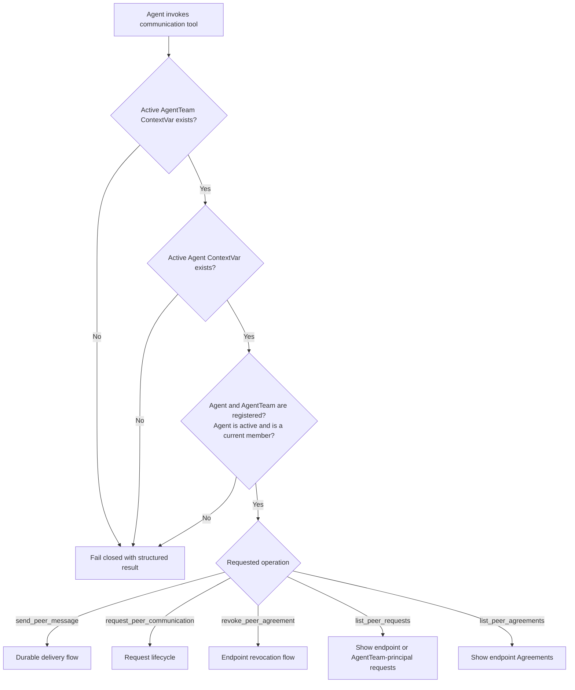
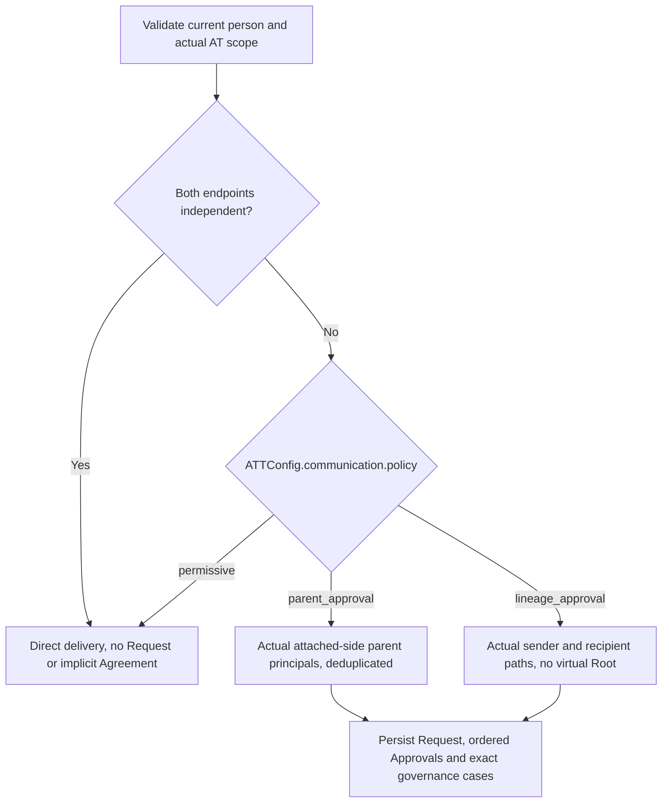
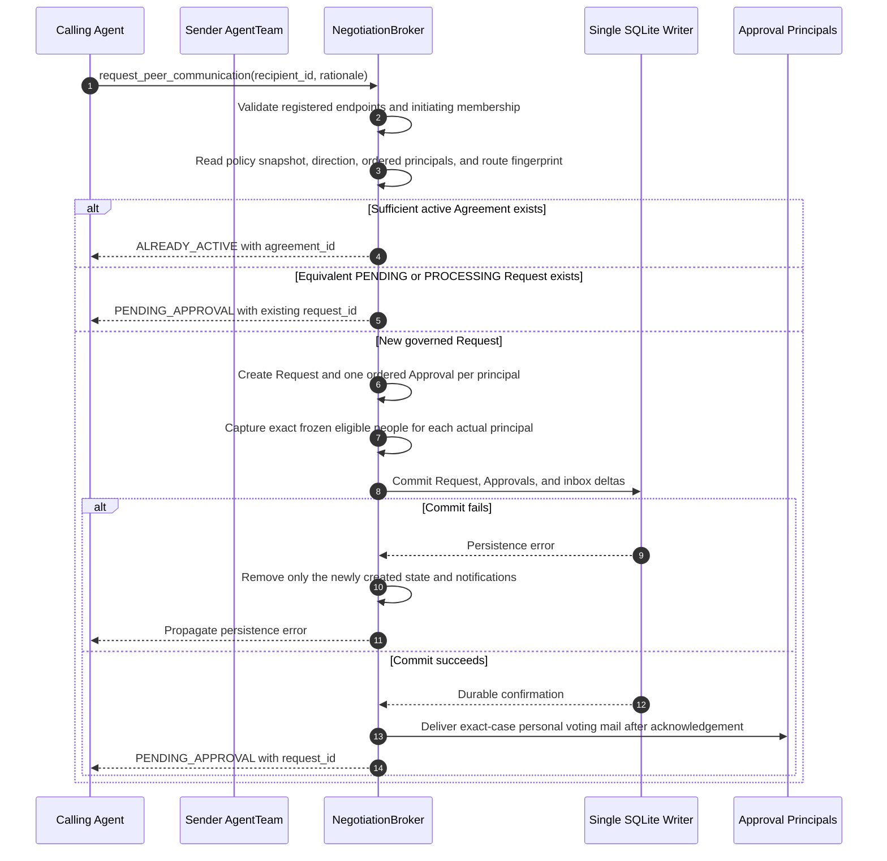
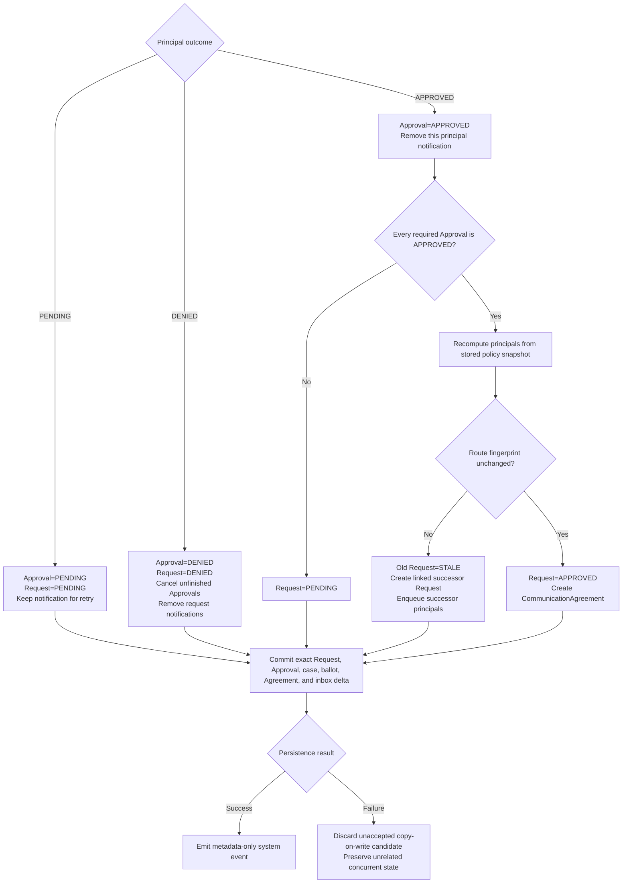
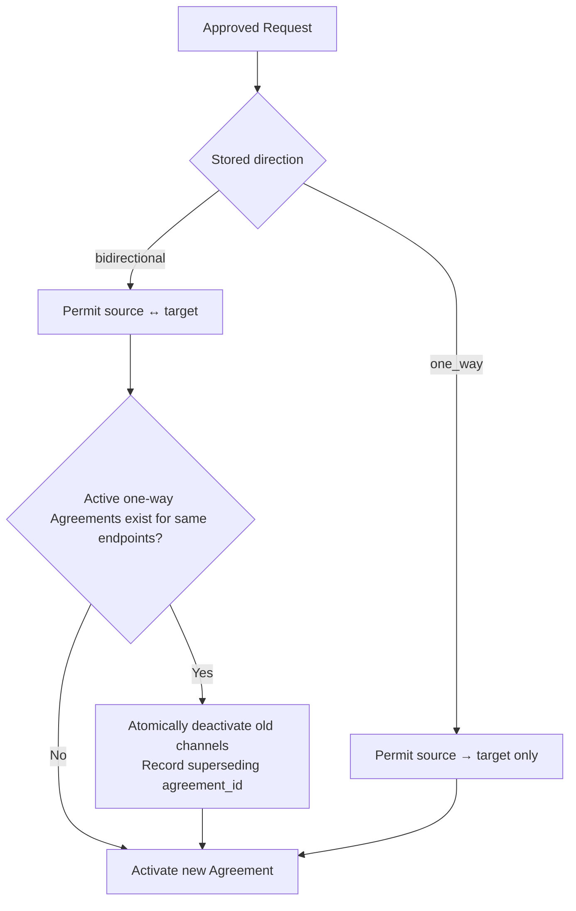
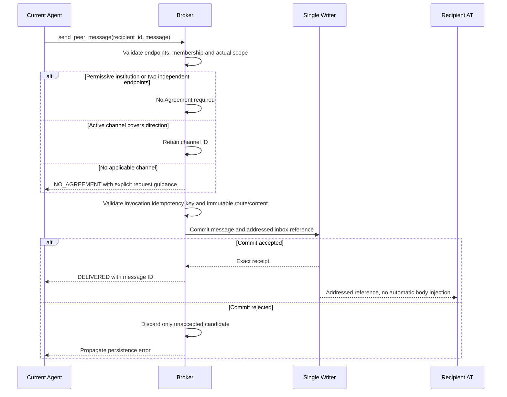
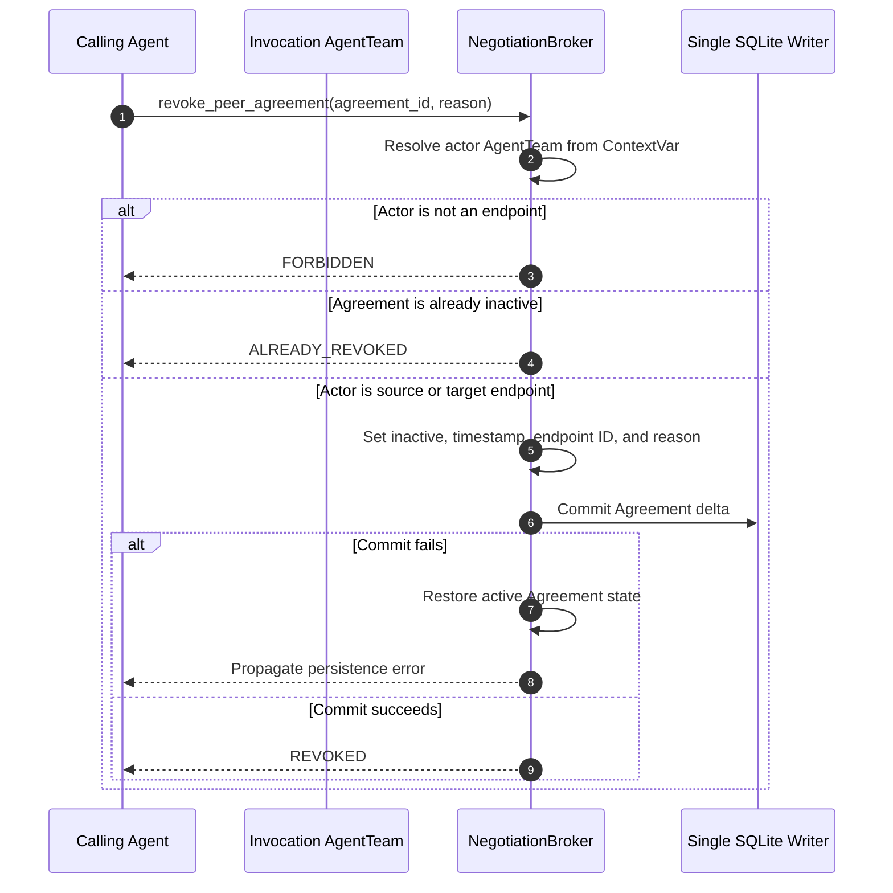
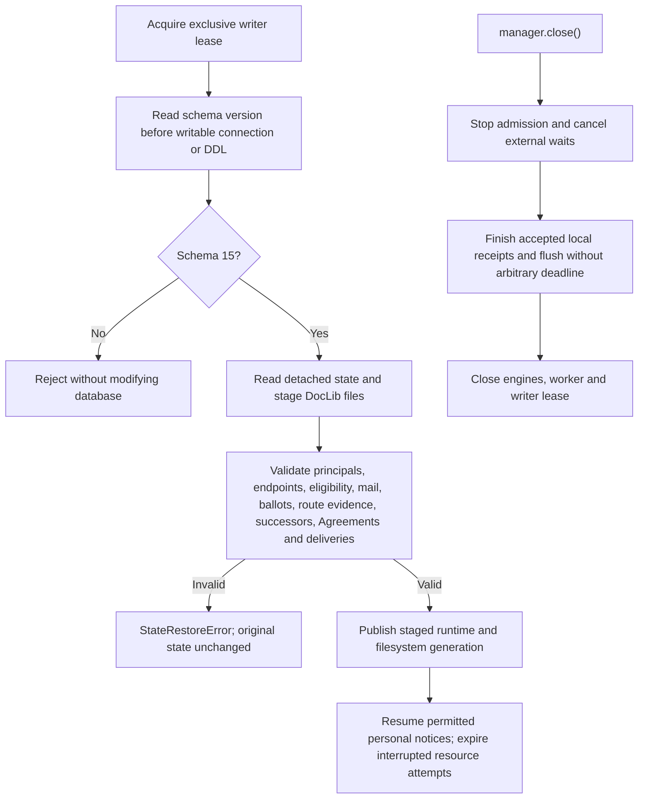

# Autonomous Communication Governance

This document maps the complete lifecycle of ATT communication authority, channel approval, durable delivery, recovery, and revocation.

`ATTConfig` defines the communication institution for every AgentTeam at every topology depth.

An Agent performs the tool invocation, but all communication authority comes from its invocation-scoped AgentTeam.

## 1. Authority Boundary and Public Operations

Communication tools resolve both the active Agent and active AgentTeam from invocation `ContextVar` state.

The Agent must be active, registered, and a current member of that AgentTeam.

The tools do not accept sender, policy, direction, mode, or approval-principal overrides.



The Root AI is an `agent` governance principal and is never a communication endpoint.

| Operation | Structured statuses |
| --- | --- |
| `send_peer_message` | `DELIVERED`, `NO_AGREEMENT` |
| `request_peer_communication` | `APPROVED`, `PENDING_APPROVAL`, `DENIED`, `ALREADY_ACTIVE` |
| `revoke_peer_agreement` | `REVOKED`, `ALREADY_REVOKED`, `FORBIDDEN` |

## 2. Communication Institution Selection

ATTConfig alone defines policy; an immutable policy snapshot and actual organizational route evidence accompany each governed Request.

`request_delivery` accepts only `"queue"`, while `direction` selects one-way or bidirectional channels.

Changing configuration cannot rewrite pending policy snapshots or revoke existing Agreements.



## 3. Approval Principal Path Algorithms

Every authority is an `ApprovalPrincipal(kind="agent_team" | "agent", principal_id=...)`.

A team's parent is explicitly an Agent, AgentTeam, or absent.

Creator identity, member order, depth labels, and membership in another team never infer an edge.

### Parent Approval

Each attached endpoint contributes its actual parent principal, and duplicates are removed.

An independent endpoint contributes no parent approval but does not exempt the other endpoint's authorities.

Root AI participates only if it is actually recorded as an Agent parent.

### Lineage Approval

The sender's request expresses its AT's consent, so sender authority is excluded.

ATT walks the actual parent paths and includes required intermediate authorities and the recipient-side authority.

Only an independent endpoint's own side is exempt.

For `P → A` and `Q → B` in separate independent trees, A-to-B lineage approval requires P, Q, and B rather than a fabricated Root Agent.

A child of an independent parent is still attached and retains its configured approval obligations.

Captured edge identities and position revisions make relevant topology changes detectable without invalidating requests after unrelated changes.

## 4. CommunicationRequest Creation and Deduplication

`request_peer_communication()` never sends a message and never creates a request under the permissive institution.

Under an approval institution, the request operation first checks for an already sufficient Agreement and then checks for an equivalent pending request.



Equivalent pending requests are matched by endpoints, direction, and policy snapshot.

A denied request does not prevent a later request with a new request ID and rationale.

## 5. Queue Delivery Through Personal Activity

Each case creates addressed voting email for the exact eligible people.

Notice presentation uses the same continuing identity, personal instructions, memory, model lock, and checkpoint mechanism as ordinary activity.

No initiating tool waits for another person's model work or acquires a whole-team discussion lock.

Receiving mail does not force scope changes, automatically mark mail read, or require a response.

Unsupported communication wake is rejected instead of becoming a hidden all-member session.

## 6. AgentTeam Governance Decision

A case freezes the principal, eligible active members, electorate revision, business request, and strict choice schema.

```mermaid
sequenceDiagram
    participant Broker
    participant Cases as GovernanceService
    participant Writer as Single Writer
    participant People as Frozen Eligible People
    Broker->>Cases: Prepare exact approval case
    Cases->>Writer: Commit case, eligibility and personal mail
    Writer-->>People: Eligible notice at personal checkpoint
    opt Person explicitly opens the email
        People->>Cases: open_agent_mail(message_id)
        Cases-->>People: Public request, exact case and choice schema
    end
    opt Person explicitly chooses
        People->>Writer: submit_governance_choice(case_id, choice)
        Writer-->>Cases: Exact immutable ballot receipt
    end
    alt Every voter submitted valid choice and strict majority true
        Cases-->>Broker: APPROVED
    else Every voter submitted valid choice and strict majority false
        Cases-->>Broker: DENIED
    else Missing, invalid, tied or changed eligibility
        Cases-->>Broker: No authority; preserve pending business request
    end
```

Strings, numbers, null, missing required fields, and extra fields are invalid boolean ballots.

Every frozen voter must produce a valid ballot before majority becomes authoritative.

Mail opening, read receipts, notification presentation, ordinary model output, and team chat cannot supply a missing vote.

An accepted ballot is immutable and survives a cancelled observer or later ordinary activity failure.

An explicit retry after a tie or electorate change may solicit a fresh case without rewriting prior choices or automatically creating a revote loop.

## 7. Agent Governance Decision

An Agent principal has one exact eligible voter: that Agent.

It receives the same addressed case mail and chooses through its ordinary personal runtime.

An unavailable Agent, missing response, invalid choice, failure, or cancellation creates no consent.

No substitute voter, generic ballot persona, temporary representative, or alternate memory chain is created.

Root uses this ordinary Agent path only when an actual organizational route names Root.

## 8. Approval Completion, Denial, and STALE Successors

Approval completion mutates communication state under the manager-level communication transaction lock without holding that lock during LLM work.



A relevant topology change produces a linked successor instead of applying an authorization from the old route.

An unrelated topology change does not alter the route fingerprint and does not invalidate the request.

## 9. CommunicationAgreement Direction and Supersession

An approved request creates exactly one persistent Agreement.



An active bidirectional Agreement satisfies later requests in either endpoint order.

Opposite one-way Agreements may coexist until a bidirectional Agreement supersedes them.

Agreements remain active until an endpoint revokes them explicitly.

## 10. Durable Peer Message Delivery and Reading

`send_peer_message()` sends only; it never automatically creates a Request.



The same invocation key and identical payload return the original message reference.

Reusing the key for different content or endpoints fails.

`list_peer_messages()` returns endpoint-authorized references without message bodies.

`read_peer_message(message_id)` performs a live endpoint membership check before explicit body access.

Mail presentation and reading do not fabricate a reply, successful business handling, or approval.

System events and callbacks carry IDs, endpoints, paths, operation types, and outcomes without peer-message content.

## 11. Endpoint Revocation

Only the source or target AgentTeam may revoke an Agreement.

Approval principals and unrelated AgentTeams cannot revoke the channel.



Revocation does not delete historical requests, approvals, ballots, Agreements, or delivery records.

## 12. Persistence, Restore, and Shutdown

Schema 15 retains exact governance cases, frozen electorate bindings, personal mail, explicit ballots, captured organization paths, Agreements, and peer-delivery records.



Processing claims reset to pending only after their retained authority combinations validate.

Interrupted resource attempts expire without replay, while historical mail and accepted choices remain retained.

A second writer manager fails immediately.

The coordinator retains at most one executing delta and one mergeable pending delta.

Invalid references, unauthorized principals, broken successor chains, duplicate active Agreements, or orphan delivery references fail restore without partially changing the live manager.

## 13. Isolation Invariants

* Communication Agreements never grant DocLib ACL, public-discovery, managed-link, or file permissions.
* A communication AgentTeam cannot use an Agent's Private DocLib unless that Agent explicitly invokes a private tool as its owner.
* Communication rationale and peer-message content do not become authority credentials.
* Root AI governance authority does not make Root AI a peer-message endpoint.
* AgentTeam authority is recorded as the AgentTeam even though individual Agents provide ballots and tool invocations.
* Member order, creator identity, role labels, and model availability never create implicit communication authority.
