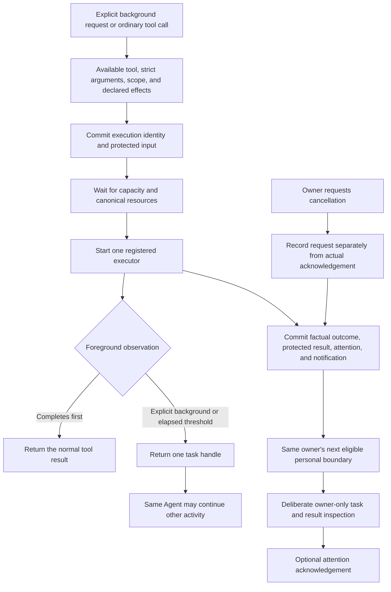

# Registered Execution and Background Tasks

Automatic detachment starts from actual execution time, excludes initial queueing, and never restarts the operation.

The original provider call receives one observation, while later results use personal notification rather than a second tool reply.

Source and mutation permissions remain live, and interruption recovery never automatically replays or reconnects a historical execution.
