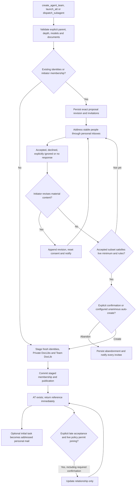
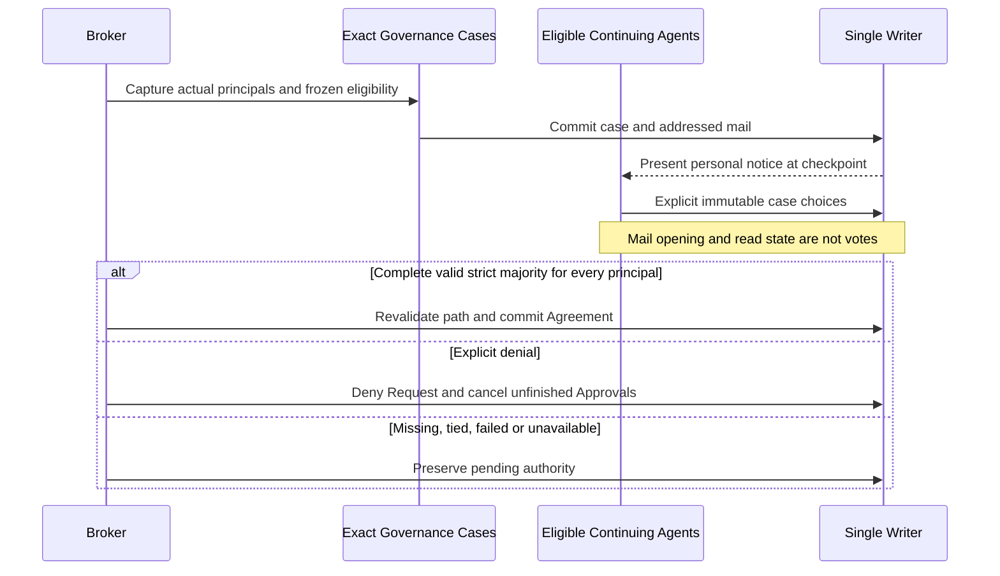
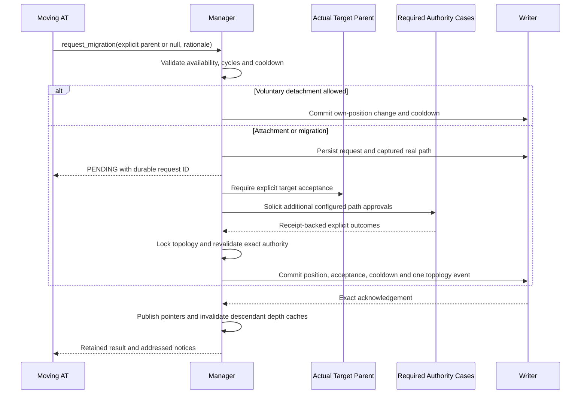

# Lineage Tree Mutations Flowcharts

ATT tracks an explicit forest with Agent, AgentTeam, or absent parents.

Creator provenance and membership never manufacture an organizational edge.

## 1. Dynamic Spawning & Tool Binding

The initiator may optionally prepare and publish a validated candidate authored in current activity.

There is no compulsory draft discussion, detached synthesis, synchronous wait for invitees, or wait for child business completion.

Failure of later activity does not undo a successfully committed team.

## 2. Communication Request Routing

Communication policy comes only from ATTConfig.

Permissive endpoints and two independent endpoints deliver without an implicit channel.

Approval institutions retain actual path evidence and solicit exact personal-mail cases without a team execution barrier.

See [Autonomous Communication Governance](Autonomous_Communication_Governance.md) for the complete routing algorithm.

## 3. Autonomous Approval & Agreement Sequence

No member order, creator identity, or virtual Root selects a substitute principal.

## 4. Dynamic Lineage Migration

Successful changes to the team's own position start the confirmed 600-second cooldown.

Denial, failed publication, inherited movement, and forced parent loss do not charge it.

## 5. Democratic Membership Voting Sequence

Membership proposals retain identity-validated Agree/Disagree/Abstain ballots under the team's structural lock.

Eligible execution updates membership intervals and runtime relationships with one receipt rather than waiting for a round boundary.

Adding or removing a relationship never resets any existing person's identity, instructions, model, memory, or private workspace.

## 6. Parent Loss and Independent Reattachment

Retiring an Agent parent or dissolving an AgentTeam parent detaches surviving direct children.

Their descendants remain attached to those surviving children.

No virtual Root adoption or automatic membership change occurs.

An independent AT may later seek a new actual parent, whose explicit acceptance remains required even under permissive migration.
