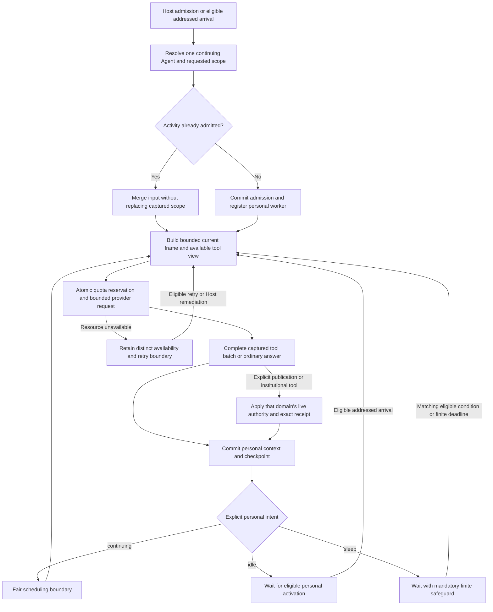

# Continuing Personal Activity

An ordinary answer supplies neither an automatic publication nor a ballot, team-wide completion signal, or idle choice.

AgentTeam membership changes relationships while the Agent retains personal identity, memory, private artifacts, and its serial invocation mechanism.

Notification suppression affects ordinary presentation rather than source delivery or explicit read authority, and protected notices retain their separate bypass rules.

See [Personal Activity](../Personal_Activity.md) for sleep, suppression, recovery, lifecycle, and provider-availability details.
