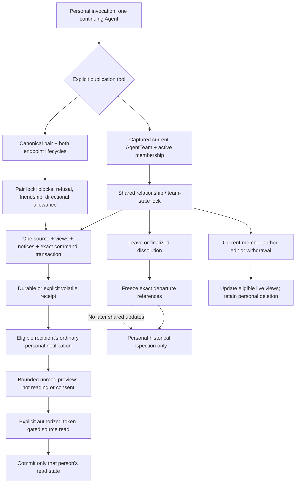

# Personal Conversations and Relationship Authority

Ordinary answers, tool observations, personal mail, AT-to-AT Agreements, and DocLib permissions do not implicitly publish chat content or grant conversation authority.

Source withdrawal exposes a marker in the live source while previously captured unread recipient reminders and authorized frozen archives retain their separate historical evidence.

Rejoining opens a new interval without revealing absence-period messages or updating an earlier frozen archive.
