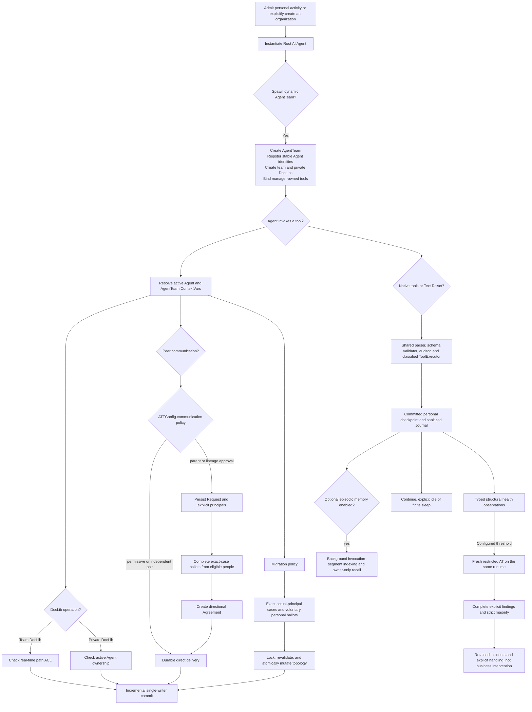

# ATT Autonomy Suite Flowcharts

This directory contains technical flowcharts and Mermaid sequence diagrams for the ATT autonomy, governance, persistence, and dynamic delegation systems.

## Flowchart Index

1. **[ATT System Architecture](System_Architecture.md)**: Shows the complete system map across host integration, identity, topology, personal activity, governance, knowledge, supervision, persistence, and recovery.
2. **[Autonomous Communication Governance](Autonomous_Communication_Governance.md)**: Shows configuration-owned communication policy, explicit governance principals, request lifecycle, agreements, revocation, and durable peer delivery.
3. **[Lineage Tree Mutations](Lineage_Tree_Mutations.md)**: Shows dynamic AgentTeam spawning, tool binding, membership voting, explicit-principal migration governance, and atomic topology mutation.
4. **[Token-Based File Reading](Gated_Reading.md)**: Shows effective-model counter resolution, token-safe range continuation, and DocLib authorization.
5. **[Tooling & Execution Engines](Tooling_and_Execution.md)**: Shows tool auditing, bounded personal invocations, native tool calling, and parallel tool execution.
6. **[State Persistence & Recovery](State_Persistence.md)**: Shows task-local batching, the coalescing single-writer queue, incremental commits, and validated atomic restore.
7. **[Selective Episodic Memory](Selective_Episodic_Memory.md)**: Shows the optional personal-invocation segmentation, isolated indexing, owner-only search, ephemeral recall, retention, forget, and Journal boundaries.
8. **[Supervision & Emergencies](Supervision_and_Emergencies.md)**: Shows supervisory audits, typed thresholds, fresh temporary audit ATs, and explicit incident handling.
9. **[Registered Execution & Background Tasks](Background_Tasks.md)**: Shows admission, same-execution detachment, owner-only results, notifications, and cancellation evidence.

## Unified High-Level Flow Overview

The ATT suite coordinates these systems through invocation-scoped authority, serialized local decisions, and asynchronous incremental persistence.

