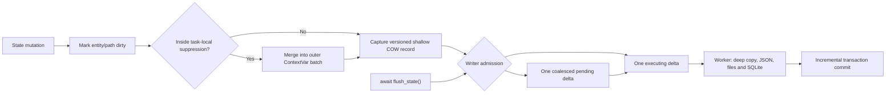
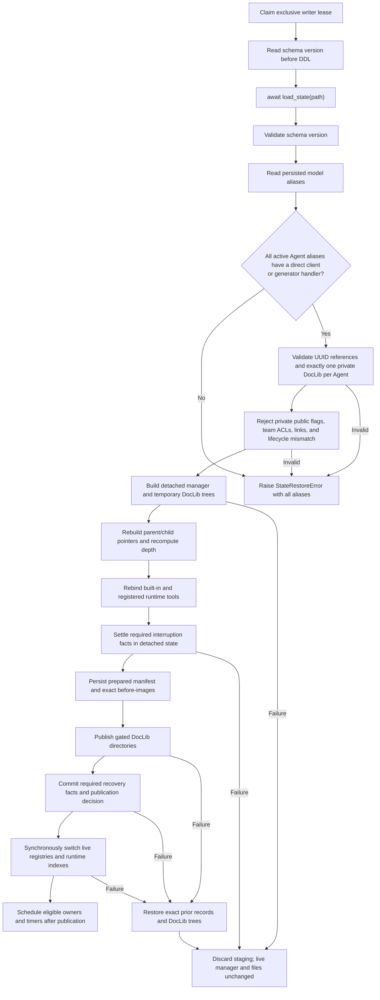

# State Persistence and Recovery Flow

- SQLite uses foreign keys, WAL, and an explicit busy timeout.
- A second manager or process fails its non-blocking writer lease immediately.
- Schema 16 retains personal, institutional, memory, chat, and execution history and adds suppression lifecycle, source-count summary coverage, and recoverable before-images for required publication changes.
- Restore cross-validates personal emails against cases and voters, resets communication processing states, and expires interrupted failover attempts without treating read receipts as ballots or deleting historical choices.
- Audit-scoped supervisory teams and auditors stay live only during their audit; snapshots exclude their identities and DocLibs, while audit-specific tables retain scoped evidence and results.
- Position events include parent acceptance and cooldown prerequisites; stale projections cannot replace accepted parent edges.
- Health observations, incidents, occurrence generations, scoped audit requests, findings, and results validate before publication.
- Sleep and timed reminder preferences resume saved monotonic remainders from restoration start; expired safeguards dispatch only after publication.
- Affected active owners wake without replaying old external work, while unaffected sleepers and retained dead identities do not activate.
- Dead identities retain historical creators, messages, and private artifacts and cannot be reactivated.
- It intentionally does not migrate old databases.
