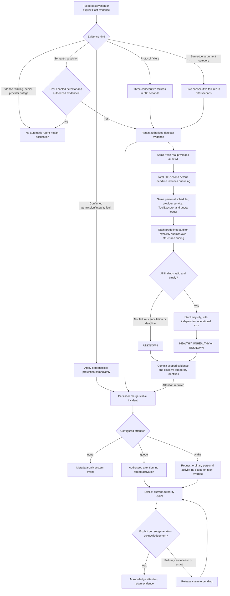

# Supervision and Incident Flow

Health detection requests inspection rather than deciding that a person is unhealthy.

A valid provider response resets the protocol streak, while a successful call resets the same tool's argument streak.

The 600-second observation window never becomes an incident TTL.

Audit findings grant no implicit repair, membership, file, permission, or model authority.

Temporary audit activity does not recursively trigger new assessments.

Parent failover has a separate default 120-second resource deadline.
