# ATT System Architecture

This overview shows the common personal runtime, explicit organizational forest, coordination surfaces, and durable authority boundaries.

```mermaid
flowchart TB
    subgraph Host["Host Integration"]
        App["Host Application"]
        Config["Strict ATTConfig<br/>shared institutions and resource limits"]
        Bindings["Model, Tool, Auditor, and Observer Bindings"]
        Manager["ATTManager"]
        App --> Manager
        Config --> Manager
        Bindings --> Manager
    end

    subgraph Organization["People and Explicit Organizations"]
        People["Stable Agent Identities<br/>Root is an Agent, not an implicit substitute"]
        Membership["Consensual Memberships<br/>team_id ↔ agent_id"]
        Forest["Organizational Forest<br/>independent, Agent parent, or AT parent"]
        Discovery["Public Entity Discovery<br/>no automatic access or membership"]
        Formation["Exact-Revision Invitations<br/>four attitudes and optional candidates"]
        Position["Accepted Position Changes<br/>target consent, cycle checks, cooldown"]
        Private["One Private DocLib per Person"]
        Shared["Team DocLibs and Live Path ACLs"]
        People --> Membership --> Forest
        People --> Private
        Forest --> Shared
        People --> Discovery
        Forest --> Discovery
        Formation --> Membership
        Position --> Forest
    end

    subgraph Runtime["One Continuing Personal Runtime"]
        Inbox["Personal Mail and Addressed Notifications"]
        Activity["Deduplicated Personal Admission"]
        Lock["One Serial Invocation per Person"]
        Boundary["Frames and Durable Checkpoints<br/>continue, change scope, idle, finite sleep"]
        Model["Bounded Model Requests<br/>typed retry, atomic quota, late fencing"]
        Tools["Common ToolExecutor<br/>strict schema, active scope, auditor, typed result"]
        Executor["Registered Execution and Resources"]
        Background["Same-Owned Background Tasks<br/>detachment, health, explicit result reads"]
        Inbox --> Activity --> Lock --> Boundary
        Boundary --> Model --> Boundary
        Boundary --> Tools --> Executor
        Executor --> Background
        Background -->|addressed result reference| Inbox
        Tools -->|complete batch| Boundary
        Boundary -->|continuing yield| Activity
    end

    subgraph Coordination["Autonomous Communication and Governance"]
        Chat["Explicit Team and Personal Chat<br/>versions, withdrawal, frozen personal views"]
        Contact["Personal Contact Controls<br/>friendship, blocks, stranger allowance"]
        Cases["Governance Cases and Immutable Ballots<br/>complete electorate, explicit choices, strict majority"]
        Peer["AT Peer Communication<br/>policy snapshots, channels, idempotent delivery"]
        Resource["Bounded Parent Resource Decisions<br/>own deadline, no representative or auto fallback"]
        Health["Health Evidence and Configured Detectors<br/>thresholds request assessment, not intervention"]
        Audit["Fresh Restricted Supervisory AT<br/>common runtime, all findings, total deadline"]
        Incidents["Persistent Deduplicated Incidents<br/>protected attention and explicit acknowledgement"]
        Contact --> Chat
        Cases --> Peer
        Cases --> Position
        Cases --> Resource
        Health --> Audit --> Incidents
        Health -->|confirmed integrity fault: immediate protection| Incidents
    end

    subgraph Memory["Agent-Owned Knowledge and Memory"]
        Window["Bounded Working Context"]
        Journal["Append-Only Sanitized Journal"]
        Catalog["Optional Episodic Catalog<br/>isolated indexing, owner-only recall"]
        Files["Token-Gated Reads and Explicit Publication<br/>live ACLs and managed links"]
        Journal --> Catalog --> Window
        Private --> Files
        Shared --> Files
    end

    subgraph Durability["Durability, Recovery, and Observation"]
        Delta["Immutable Entity and Domain Deltas"]
        Writer["One Exclusive Coalescing Writer"]
        Database[(SQLite Schema 15)]
        Restore["Validated Staging and Atomic Recovery<br/>causal references, no external replay"]
        Events["Ordered Metadata-Only System Events"]
        Delta --> Writer --> Database --> Restore
        Events --> App
    end

    Manager --> People
    Manager --> Forest
    Manager --> Activity
    Tools --> Formation
    Tools --> Chat
    Tools --> Contact
    Tools --> Peer
    Tools --> Position
    Tools --> Cases
    Tools --> Files
    Cases -->|addressed voluntary voting mail| Inbox
    Peer -->|message references| Inbox
    Chat -->|authorized notices| Inbox
    Model -->|resource remedy handle| Resource
    Resource -->|authorized binding change| Model
    Position -->|affected-person notices| Inbox
    Incidents -->|queue or wake attention; no forced decision| Inbox
    Audit -->|restricted profile| Activity
    Model -->|typed protocol evidence| Health
    Tools -->|classified operation evidence| Health
    Boundary --> Window
    Boundary --> Journal
    Window --> Model
    Files -->|explicit authorized observation| Window
    Membership --> Delta
    Forest --> Delta
    Boundary --> Delta
    Executor --> Delta
    Cases --> Delta
    Peer --> Delta
    Chat --> Delta
    Journal --> Delta
    Files --> Delta
    Audit --> Delta
    Incidents --> Delta
    Restore --> Manager
    Delta --> Events

    classDef host fill:#eceff1,stroke:#455a64,stroke-width:1.5px;
    classDef identity fill:#e3f2fd,stroke:#1976d2,stroke-width:1.5px;
    classDef execution fill:#fffde7,stroke:#f9a825,stroke-width:1.5px;
    classDef governance fill:#fce4ec,stroke:#c2185b,stroke-width:1.5px;
    classDef knowledge fill:#e8f5e9,stroke:#388e3c,stroke-width:1.5px;
    classDef supervision fill:#fff3e0,stroke:#ef6c00,stroke-width:1.5px;
    classDef persistence fill:#ede7f6,stroke:#5e35b1,stroke-width:1.5px;
    style Host fill:#f4f7f9,stroke:#455a64,stroke-width:2px,color:#1f2937;
    style Organization fill:#eff6ff,stroke:#1976d2,stroke-width:2px,color:#1f2937;
    style Runtime fill:#fffbeb,stroke:#f9a825,stroke-width:2px,color:#1f2937;
    style Coordination fill:#fff1f2,stroke:#c2185b,stroke-width:2px,color:#1f2937;
    style Memory fill:#ecfdf5,stroke:#00796b,stroke-width:2px,color:#1f2937;
    style Durability fill:#f5f3ff,stroke:#5e35b1,stroke-width:2px,color:#1f2937;
    class App,Config,Bindings,Manager host;
    class People,Membership,Forest,Discovery,Formation,Position identity;
    class Inbox,Activity,Lock,Boundary,Model,Tools,Executor,Background execution;
    class Chat,Contact,Cases,Peer,Resource governance;
    class Private,Shared,Window,Journal,Catalog,Files knowledge;
    class Health,Audit,Incidents supervision;
    class Delta,Writer,Database,Restore,Events persistence;
```

## Reading Guide

- Colored outer boxes identify major subsystems, not separate Agent identities or inference engines.
- Membership and organizational parenthood are independent relationships.
- Publications, personal mail, ballots, and background results retain distinct authority and read-state semantics.
- Governance and fresh temporary audit teams use the common runtime, with specialized data and tool restrictions rather than a second execution loop.
- Runtime publication follows an exact accepted receipt; restore validates staged state before exposing it.

See the [flowchart index](README.md) for detailed state machines and failure boundaries.
