# ATT System Architecture

This technical map expands the [README overview](../../README.md#-system-architecture) with subsystem dependencies, authority boundaries, and the main paths between personal activity, institutions, knowledge, and persistence.

Module-specific state machines and failure handling remain in the linked subsystem guides.

```mermaid
flowchart TB
    subgraph Host["Host Integration"]
        App["Host Application"]
        Config["Strict ATTConfig<br/>shared institutions and resource limits"]
        Bindings["Model, Tool, Auditor, and Observer Bindings"]
        Manager["ATTManager"]
        App --> Manager
        Config --> Manager
        Bindings --> Manager
    end

    subgraph Organization["People and Explicit Organizations"]
        People["Stable Agent Identities<br/>Root is an Agent, not an implicit substitute"]
        Membership["Consensual Memberships<br/>team_id ↔ agent_id"]
        Forest["Organizational Forest<br/>independent, Agent parent, or AT parent"]
        Discovery["Public Entity Discovery<br/>no automatic access or membership"]
        Formation["Exact-Revision Invitations<br/>four attitudes and optional candidates"]
        Position["Accepted Position Changes<br/>target consent, cycle checks, cooldown"]
        Private["One Private DocLib per Person"]
        Shared["Team DocLibs and Live Path ACLs"]
        People -->|member identities| Membership
        Forest -->|team identities| Membership
        People --> Private
        Forest --> Shared
        People --> Discovery
        Forest --> Discovery
        Formation --> Membership
        Position --> Forest
    end

    subgraph Runtime["One Continuing Personal Runtime"]
        Inbox["Personal Mail and Addressed Notifications"]
        Activity["Deduplicated Personal Admission"]
        Lock["One Serial Invocation per Person"]
        Boundary["Frames and Durable Checkpoints<br/>continue, change scope, idle, finite sleep"]
        Model["Bounded Model Requests<br/>typed retry, atomic quota, late fencing"]
        Tools["Common ToolExecutor<br/>strict schema, active scope, auditor, typed result"]
        Executor["Registered Execution and Resources"]
        Background["Same-Owned Background Tasks<br/>detachment, health, explicit result reads"]
        Inbox --> Activity --> Lock --> Boundary
        Boundary --> Model --> Boundary
        Boundary -->|tool calls| Executor
        Executor -->|coordinated invocation| Tools
        Tools -->|typed result| Executor
        Executor -->|eligible background execution or detachment| Background
        Background -->|addressed result reference| Inbox
        Executor -->|accepted foreground observation or task handle| Boundary
        Boundary -->|continuing yield| Activity
    end

    subgraph Coordination["Autonomous Communication and Governance"]
        Chat["Explicit Team and Personal Chat<br/>versions, withdrawal, frozen personal views"]
        Contact["Personal Contact Controls<br/>friendship, blocks, stranger allowance"]
        Cases["Governance Cases and Immutable Ballots<br/>complete electorate, explicit choices, strict majority"]
        Peer["AT Peer Communication<br/>policy snapshots, channels, idempotent delivery"]
        Resource["Bounded Parent Resource Decisions<br/>own deadline, no representative or auto fallback"]
        Health["Health Evidence and Configured Detectors<br/>thresholds request assessment, not intervention"]
        Audit["Fresh Restricted Supervisory AT<br/>common runtime, all findings, total deadline"]
        Incidents["Persistent Deduplicated Incidents<br/>protected attention and explicit acknowledgement"]
        Contact --> Chat
        Cases --> Peer
        Cases --> Position
        Cases --> Resource
        Health -->|threshold: retain incident before audit admission| Incidents
        Health -->|threshold assessment after incident commit| Audit
        Audit -->|non-healthy or operationally degraded result| Incidents
        Health -->|confirmed integrity fault: immediate protection| Incidents
    end

    subgraph Memory["Agent-Owned Knowledge and Memory"]
        Window["Bounded Working Context"]
        Journal["Append-Only Sanitized Journal"]
        Catalog["Optional Episodic Catalog<br/>isolated indexing, owner-only recall"]
        Files["Token-Gated Reads and Explicit Publication<br/>live ACLs and managed links"]
        Journal -->|optional indexing| Catalog
        Catalog -->|explicit transient recall| Window
        Private --> Files
        Shared --> Files
    end

    subgraph Durability["Durability, Recovery, and Observation"]
        Delta["Immutable Entity and Domain Deltas"]
        Writer["One Exclusive Coalescing Writer"]
        Database[(SQLite Schema 16)]
        Restore["Validated Staging and Atomic Recovery<br/>causal references, no external replay"]
        Events["Ordered Metadata-Only System Events"]
        Delta --> Writer --> Database --> Restore
        Events --> App
    end

    Manager --> People
    Manager --> Forest
    Manager --> Activity
    Manager -->|explicit Host assessment request| Audit
    Tools --> Formation
    Tools --> Chat
    Tools --> Contact
    Tools --> Peer
    Tools --> Position
    Tools --> Cases
    Tools --> Files
    Formation -->|addressed revision invitations| Inbox
    Cases -->|addressed voluntary voting mail| Inbox
    Peer -->|message references| Inbox
    Chat -->|authorized notices| Inbox
    Model -->|configured parent failover only| Resource
    Resource -->|authorized binding change| Model
    Position -->|affected-person notices| Inbox
    Incidents -->|actual handler: queue or wake attention| Inbox
    Incidents -->|no designated organizational handler| Events
    Audit -->|restricted profile| Activity
    Model -->|typed protocol evidence| Health
    Tools -->|classified operation evidence| Health
    Boundary --> Window
    Boundary --> Journal
    Window --> Model
    Catalog -.->|deliberately retained compact references in instructions| Model
    Files -->|explicit authorized observation| Window
    Membership --> Delta
    Formation --> Delta
    Forest --> Delta
    Boundary --> Delta
    Executor --> Delta
    Cases --> Delta
    Peer --> Delta
    Chat --> Delta
    Journal --> Delta
    Files --> Delta
    Audit --> Delta
    Incidents --> Delta
    Restore --> Manager
    Delta --> Events

    classDef host fill:#eceff1,stroke:#455a64,stroke-width:1.5px;
    classDef identity fill:#e3f2fd,stroke:#1976d2,stroke-width:1.5px;
    classDef execution fill:#fffde7,stroke:#f9a825,stroke-width:1.5px;
    classDef governance fill:#fce4ec,stroke:#c2185b,stroke-width:1.5px;
    classDef knowledge fill:#e8f5e9,stroke:#388e3c,stroke-width:1.5px;
    classDef supervision fill:#fff3e0,stroke:#ef6c00,stroke-width:1.5px;
    classDef persistence fill:#ede7f6,stroke:#5e35b1,stroke-width:1.5px;
    style Host fill:#f4f7f9,stroke:#455a64,stroke-width:2px,color:#1f2937;
    style Organization fill:#eff6ff,stroke:#1976d2,stroke-width:2px,color:#1f2937;
    style Runtime fill:#fffbeb,stroke:#f9a825,stroke-width:2px,color:#1f2937;
    style Coordination fill:#fff1f2,stroke:#c2185b,stroke-width:2px,color:#1f2937;
    style Memory fill:#ecfdf5,stroke:#00796b,stroke-width:2px,color:#1f2937;
    style Durability fill:#f5f3ff,stroke:#5e35b1,stroke-width:2px,color:#1f2937;
    class App,Config,Bindings,Manager host;
    class People,Membership,Forest,Discovery,Formation,Position identity;
    class Inbox,Activity,Lock,Boundary,Model,Tools,Executor,Background execution;
    class Chat,Contact,Cases,Peer,Resource governance;
    class Private,Shared,Window,Journal,Catalog,Files knowledge;
    class Health,Audit,Incidents supervision;
    class Delta,Writer,Database,Restore,Events persistence;
```

## Reading Guide

- Colored outer boxes identify major subsystems, not separate Agent identities or inference engines.
- Membership and organizational parenthood are independent relationships.
- Execution registration and resource coordination precede ToolExecutor invocation; results and task handles retain their separate meanings.
- Membership changes preserve Agent-owned identity, memory, model binding, and private documents.
- Publications, personal mail, ballots, and background results retain distinct authority and read-state semantics.
- Governance and Team Formation retain their own rules, authorization, and durable state while using the common personal runtime.
- Fresh temporary audit teams use that same runtime with restricted evidence and tools.
- Threshold incidents are retained before audit admission, and incident attention reaches the actual designated authority or the Host.
- Episodic recall is explicit and transient; deliberately retained compact references enter model instructions.
- Runtime publication follows an exact accepted receipt; restore validates staged state before exposing it.

## Subsystem Guides

| Topic | Detailed documentation |
| --- | --- |
| Identity, ownership, and discovery | [Core objects](../Core_Objects_Model.md), [Agent and AgentTeam discovery](../Agent_and_AgentTeam_Discovery.md) |
| Formation and topology | [Consensual Team Formation](../Consensual_Team_Formation.md), [lineage mutations](Lineage_Tree_Mutations.md) |
| Personal activity and lifecycle | [Personal runtime](../dev/autonomous_activity/Phase_2.md), [sleep, recovery, and retained lifecycle](../dev/autonomous_activity/Phase_6.md) |
| Governance and peer communication | [Team Governance](../Team_Governance.md), [communication flowcharts](Autonomous_Communication_Governance.md) |
| Conversations and personal contact controls | [Personal conversations](Personal_Conversations.md) |
| Tools and background execution | [Tooling and execution](Tooling_and_Execution.md), [background tasks](Background_Tasks.md) |
| Memory and document access | [Selective episodic memory](Selective_Episodic_Memory.md), [file reading and DocLib authorization](Gated_Reading.md) |
| Health supervision and incidents | [Supervision and emergencies](Supervision_and_Emergencies.md) |
| Persistence and recovery | [Persistence contract](../State_Persistence.md), [persistence flowcharts](State_Persistence.md) |

See the [flowchart index](README.md) for detailed state machines and failure boundaries.
