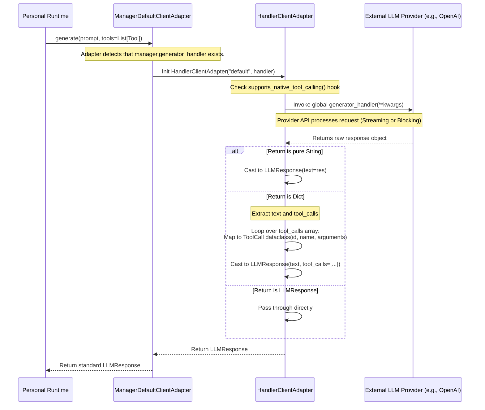
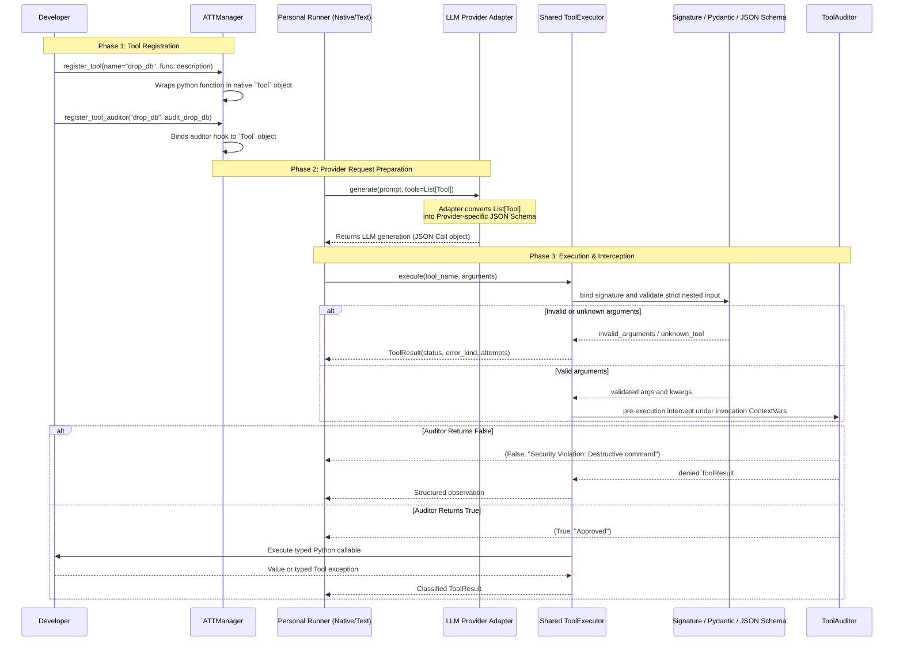
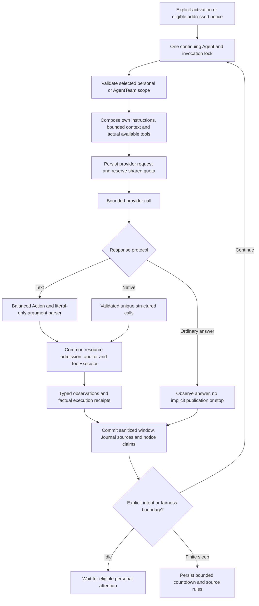

# Tooling and Execution Flowcharts

This document consolidates the sequence flows defining how tools are parsed, audited, and executed within the runtime reasoning loops of the framework, as well as the low-level adapter logic for the LLM integrations.

## 1. LLM Adapter Streaming vs Sync Execution (Deep Dive)

This sequence diagram details how `ManagerDefaultClientAdapter` wraps the global `generator_handler`, checks for native schema support, and translates raw Python generator chunks (from sync or async LLM APIs) into standardized `LLMResponse` objects containing parsed `ToolCall` data structures.

## 2. Tool Parsing & Auditor Lifecycle

This sequence diagram maps the exact lifecycle of a Python function as it is registered as an ATT Tool, routed through an adapter under the Thorough Abstraction Paradigm, generated by an LLM, intercepted by a `ToolAuditor` hook, and finally executed.

## 3. Continuing Personal Activity

Ordinary tool errors produce observations without terminating an AT or resetting another person's activity.

Typed provider failures enter resource availability handling, not a generic LLM-blame or health decision.

Fatal persistence and state-integrity failures propagate while accepted effects finish local settlement.

## 4. Institutional Work on the Same Runtime

Exact governance cases deliver voluntary personal voting mail without acquiring a whole-team discussion lock.

Temporary audit people use the same scheduler and executor with an immutable restricted evidence/tool profile and total deadline.

Registered long-running tools use the [background execution service](Background_Tasks.md), retaining one execution and one original call result or task handle.

Optional memory indexing consumes committed personal invocation segments and never copies membership-specific identities.
