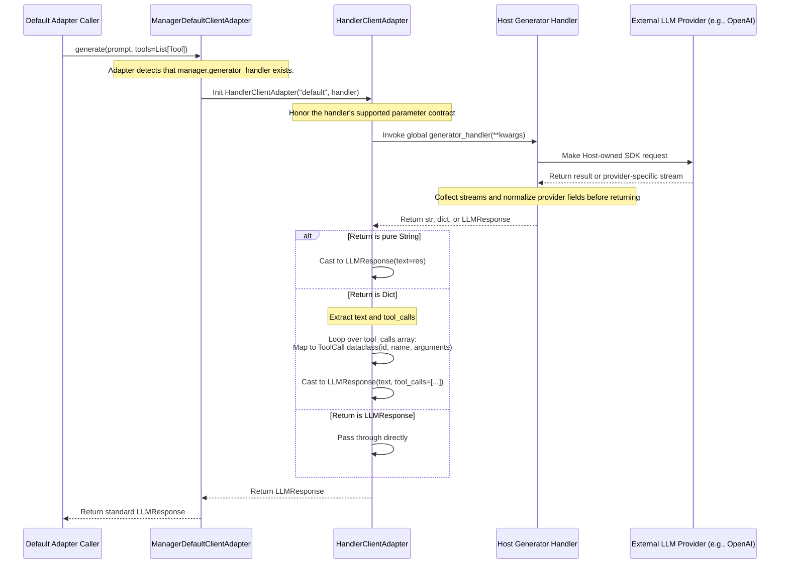
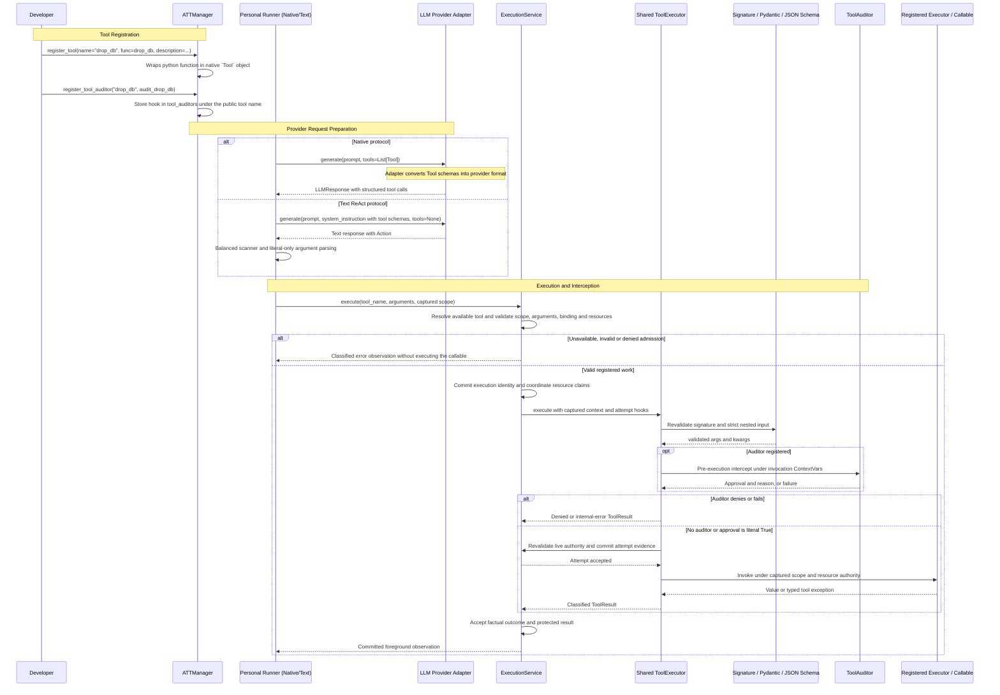
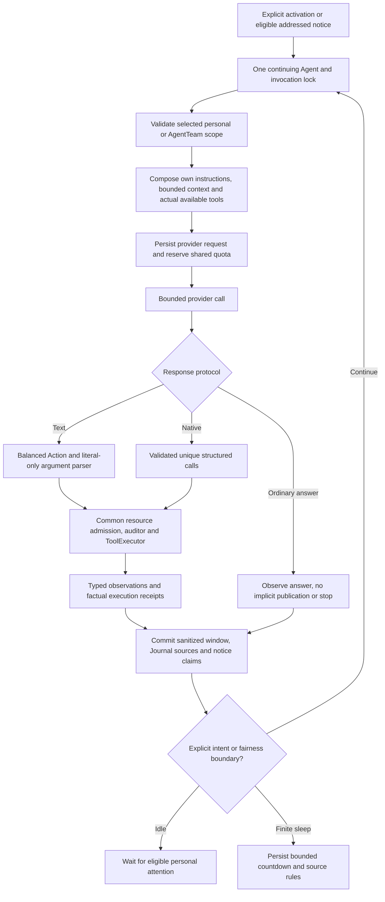

# Tooling and Execution Flowcharts

This document consolidates the sequence flows defining how tools are parsed, audited, and executed within the runtime reasoning loops of the framework, as well as the low-level adapter logic for the LLM integrations.

## 1. Generator Handler Forwarding and Response Conversion

This sequence diagram illustrates the default generator-handler adapter's forwarding and response-conversion behavior for a Native request.

The personal runtime resolves a concrete provider binding before quota reservation, and directly registered clients do not require this forwarding path.

Handlers return `str`, `dict`, or `LLMResponse`, synchronously or through an awaitable.

The Host collects provider-specific streams and assembles any streamed tool calls before returning one of these supported values; the default ATT wrapper does not consume iterators or asynchronous iterators.

## 2. Tool Parsing & Auditor Lifecycle

This sequence diagram follows a registered tool from provider request preparation through execution admission, resource coordination, optional auditing, and foreground result acceptance.

Eligible long-running work may return a handle while the same execution continues, as described in [Background Tasks](Background_Tasks.md).

## 3. Continuing Personal Activity

Ordinary tool errors produce observations without terminating an AT or resetting another person's activity.

Typed provider failures enter resource availability handling, not a generic LLM-blame or health decision.

Fatal persistence and state-integrity failures propagate while accepted effects finish local settlement.

## 4. Institutional Work on the Same Runtime

Exact governance cases deliver voluntary personal voting mail without acquiring a whole-team discussion lock.

Temporary audit people use the same scheduler and executor with an immutable restricted evidence/tool profile and total deadline.

Registered long-running tools use the [background execution service](Background_Tasks.md), retaining one execution and one original call result or task handle.

Optional memory indexing consumes committed personal invocation segments and never copies membership-specific identities.
